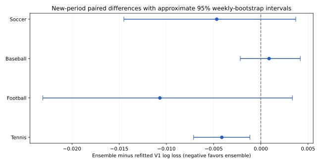

# SportsLab · Four-sport prediction research

A reproducible learning project that turns historical match results into
**pre-event outcome probabilities** for soccer, baseball, American football and
tennis. Four separately fitted model ensembles share an availability-aware research engine.

**77,235 real historical events. 50 pre-event features. Three chronological
development folds. Separate calibration years. 5,809 newer held-out matches.**

This is an AI-assisted research portfolio, not a live production forecasting
service. It does not guarantee outcomes, integrate with betting, or claim to
outperform commercial systems or university-club projects.

## Newer-period results you can audit

The expanded V2 benchmark evaluates 2025 (EPL 2025–26), after all four models were
frozen together. The original V1 recipe is refitted on the same training and
calibration periods and predicts the same new matches. This distinguishes a
modeling improvement from simply testing on a different year.

| Sport | New test games | Ensemble accuracy | Ensemble log loss | Refitted V1 log loss | Paired difference 95% interval |
| --- | ---: | ---: | ---: | ---: | --- |
| Soccer | 380 | 47.63% | 1.0265 | 1.0312 | [-0.0145, +0.0037] |
| Baseball | 2,430 | 56.21% | 0.6803 | 0.6794 | [-0.0022, +0.0042] |
| American football | 271 | 63.84% | 0.6310 | 0.6417 | [-0.0231, +0.0033] |
| Tennis | 2,728 | 65.47% | 0.6119 | 0.6160 | [-0.0071, -0.0012] |

Lower log loss is better; negative differences favor V2. These approximate
calendar-week bootstrap intervals are unadjusted descriptive uncertainty, not a
universal superiority claim. The clearest same-game V2 improvement is tennis.
Soccer and NFL improve on point estimates but remain uncertain versus refitted
V1; baseball is slightly worse. NFL and tennis also improve against calibrated
Elo with intervals below zero. The ensemble remains the main model even where an
individual family scores better.



[All family comparisons, negative results and reliability plots](reports/v2/RESULTS.md) ·
[Start with the project guide](docs/PROJECT_GUIDE.md) ·
[Fixed protocol](docs/v2/PROTOCOL.md) · [Reproduce V2](docs/v2/REPRODUCE.md) ·
[Executed validation checks](reports/VALIDATION.md)

V2 compares rating-only/extended logistic regression, gradient boosting, random
forests, Extra Trees, a soccer goal-count model, an out-of-fold ensemble, refitted
V1 and prior/Elo baselines. There are 12 development candidates per binary sport
and 13 for soccer. No new-test winner is chosen after scoring.

The requested **Laya** zero-shot experiment completed on 800 frozen V1 cases.
It had worse log loss than the simpler baselines in all four sports.
[Actual Laya results](docs/laya_experiment.md). A partial preserved FiveThirtyEight
MLB diagnostic favored its pitcher-adjusted probabilities by a small, uncertain
margin; complete comparable commercial archives were unavailable.
[External comparison and source limitations](docs/COMPARATORS.md).

## Original V1 benchmark, preserved

The smaller original experiment covers 71,349 historical events and uses five
candidate configurations per sport, two earlier backtest folds and two-year final
holdouts. These results were inspected before V2 was developed and are not new
test evidence for V2.


| Sport | Coverage | Holdout games | Selected accuracy | Selected log loss | Constant-prior log loss |
| --- | --- | ---: | ---: | ---: | ---: |
| Soccer | EPL, 2015–16 to 2024–25 | 760 | 54.47% | 0.9576 | 1.0672 |
| Baseball | MLB, 2015–2024 | 4,859 | 54.83% | 0.6836 | 0.6927 |
| American football | NFL regular seasons, 2010–2024 | 544 | 64.34% | 0.6395 | 0.6896 |
| Tennis | ATP men's singles, 2010–2024 | 5,856 | 65.22% | 0.6145 | 0.6936 |

Lower log loss is better. Accuracy is secondary. Soccer has three outcome
classes; the other tasks have two, with explicit exclusions.

[Full results, calibrated Elo comparisons, uncertainty and reliability plots](reports/RESULTS.md)

In V1, the strongest finding is tennis's improvement over calibrated Elo. Improvements
over Elo in the other three sports remain uncertain under the approximate
weekly-bootstrap intervals. Calibration slightly worsened soccer and baseball
holdout log loss; those negative results are retained. No cherry-picked model
switch after inspecting the final holdout.

## Quick start

Python 3.11 or 3.12, a normal CPU, and public internet access are sufficient for
the core models. No API key, paid account, GPU or LLM is required. Commands below
run from the repository root.

```bash
python -m venv .venv
source .venv/bin/activate                  # Windows: .venv\Scripts\activate
python -m pip install -e .
python -m unittest discover -s tests -v
bash scripts/reproduce_v2.sh              # reproduces V1, then the expanded V2 benchmark
```

The full historical experiment downloads public provider files, checks their
SHA-256 snapshot lock, validates and normalizes records, trains/evaluates each
sport, and regenerates the reports. V2 development took about 18 minutes on this
CPU environment, plus evaluation and data preparation; hardware changes runtime.
Use `bash scripts/reproduce.sh` for only the smaller V1 experiment. A separate
optional Laya experiment has much larger dependencies and is not installed here.

```bash
python -m sportslab run --sport tennis     # fetch + normalize + train + evaluate
python -m sportslab analyze --sport tennis # descriptive historical counts
python -m sportslab train --sport soccer  # reuse previously fetched/validated data
python -m sportslab --help
```

Retrosheet and nflverse release URLs can change when their providers revise
history. The reproduction script uses a compact, attributed CC-BY-4.0 NFL
normalized snapshot with separately verified original-source and representation
hashes. Other provider downloads with a different hash deliberately stop. The
repository's results are tied to the recorded snapshot, not any future bytes.
Review revisions before creating a new benchmark; never silently update the lock
to pass a failed reproduction. Pinned soccer/tennis URLs identify immutable commits.

## Predict a matchup

After expanded-benchmark reproduction, use exact participant identifiers from
data/v2/processed. `side_a`
is designated home for team sports. Tennis uses stable ATP player IDs; the CLI
canonicalizes their ordering internally and returns probabilities for the order
you requested. Rankings must be known before the tournament.

```bash
python scripts/analyze_matchup.py --sport football --side-a KC --side-b BUF --date 2026-02-01
python scripts/analyze_matchup.py --sport tennis --side-a 104745 --side-b 104925 --date 2026-02-01 --surface Hard --rank-a 200 --rank-b 7
```

These are **illustrative historical scenarios**, not assertions that these
fixtures occurred or that the supplied example rankings were real. Live future
predictions would require newly verified data, validated updates and retraining.
The CLI warns about stale history and missing tennis ranks, rejects unknown
participants unless cold starts are explicitly requested, and refuses dates before
the model's calibration cutoff. It also verifies the completed benchmark, model
and historical-input hashes. Probabilities are estimates, not guarantees.
The returned base-model range is disagreement, not a confidence interval.

Only load model.joblib files produced locally by code you trust: joblib/pickle
can execute code. Trained artifacts are deliberately excluded from Git.

## How leakage is prevented

1. Adapters expose a narrow allowlist of result, identity and pre-event fields
2. A result can update features only when available_date is strictly earlier
   than the new event date; all same-day games are frozen together
3. Retrosheet suspended games use their completion dates, not original dates
4. Tennis source dates denote tournament starts. Results are delayed 21 days;
   current-tournament match statistics never enter the feature matrix
5. Side A in tennis is assigned by player ID before mapping the winner label
6. Predefined configurations are selected on three earlier chronological V2
   folds (two for V1), then fitted on the training era only
7. Temperature calibration uses a later validation partition. The final holdout
   is used for reporting, never hyperparameter/model selection
8. Tests mutate outcomes, append future games, shuffle rows, check availability,
   verify split embargoes, and exercise the entire save/load/predict path

Test-time history rolls forward when earlier held-out results become available.
The classifier stays frozen. This estimates sequential pre-event prediction,
not a whole season forecast made before the season starts.

## Research design

- Priors: training class frequencies, Elo, and validation-calibrated Elo
- Candidates: standardized logistic regression, histogram boosting, random
  forests, Extra Trees and a soccer goal model; separate sport-specific fits
- Features: prior Elo and surface Elo differences, ten-game form/margins/scoring,
  experience/rest differences, cold-start indicators, venue designation, and
  pre-tournament tennis rank differences with missingness indicators; V2 adds
  fast/slow batch ratings, time-weighted form, opponent strength, rank transforms,
  surface/role history and absence features
- Metrics: log loss, Brier score, accuracy, top-label ECE, classwise reliability
  bins and plots, per-year breakdowns, paired weekly-bootstrap intervals
- Reproducibility: fixed seed, pinned dependencies, source hashes, strict schemas,
  code/data fingerprints, separate artifact IDs, a small inference contract

[Methodology](docs/methodology.md) · [Learning walkthrough](docs/walkthrough.md) ·
[Deployment gaps and monitoring design](docs/deployment.md) ·
[Optional Laya experiment](docs/laya_experiment.md) ·
[External/commercial comparison and its limits](docs/COMPARATORS.md)

### V2 model cards

[Soccer](docs/v2/model_cards/soccer.md) · [Baseball](docs/v2/model_cards/baseball.md) ·
[American football](docs/v2/model_cards/football.md) · [Tennis](docs/v2/model_cards/tennis.md)

### Original V1 model cards

[Soccer](docs/model_cards/soccer.md) · [Baseball](docs/model_cards/baseball.md) ·
[American football](docs/model_cards/football.md) · [Tennis](docs/model_cards/tennis.md)

## AI-assisted development and honest authorship

The initial implementation, data-source investigation, tests and documentation
were produced with substantial AI assistance. This repository is a starting
point for the owner's learning and review. It should not be described as an
independently developed production system or proof of skills the owner has not
yet practiced. The walkthrough includes experiments to reproduce and explain.
[Application wording and a personal learning record](docs/APPLICATION_NOTE.md)
help distinguish generated implementation from skills you have demonstrated.

A truthful project description is: “I am building and learning from an
AI-assisted four-sport analytics project with real historical data,
chronological evaluation, baseline comparisons and leakage tests.”

## Data rights

Original provider downloads, checkpoints, per-game features and predictions stay
local and are excluded from Git. One compact, odds-free normalized NFL input
snapshot is included under CC BY 4.0 for durable reproduction. The code is MIT; data rights are separate. Soccer uses
OpenFootball CC0, baseball Retrosheet's attribution-based terms, NFL the
nflverse-data CC BY 4.0 release, and tennis Jeff Sackmann / Tennis Abstract
CC BY-NC-SA 4.0 through a preserved licensed archive. Tennis data and covered
adaptations are **non-commercial**, even though the original code is MIT.

[Full attribution, rights and source audits](DATA_LICENSES.md)

**Retrosheet acknowledgment:** The information used here was obtained free of
charge from and is copyrighted by Retrosheet. Interested parties may contact
Retrosheet at "www.retrosheet.org".

### Frozen NFL input versus refresh

`python scripts/reproduce_frozen_nfl.py --mode frozen` reproduces the published
V1 NFL experiment from its licensed normalized input. The original source bytes
and the reduced snapshot have distinct hashes and provenance.

`python scripts/reproduce_frozen_nfl.py --mode refresh --output /tmp/nfl-review`
fetches provider data into a new review directory. It never overwrites frozen
inputs, fitted models or reports. Review schema, source changes and hashes before
creating a new experiment; refreshed data does not reproduce an old snapshot.
