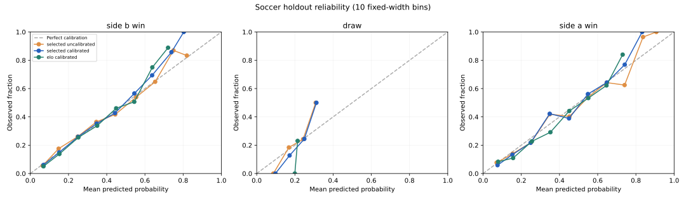
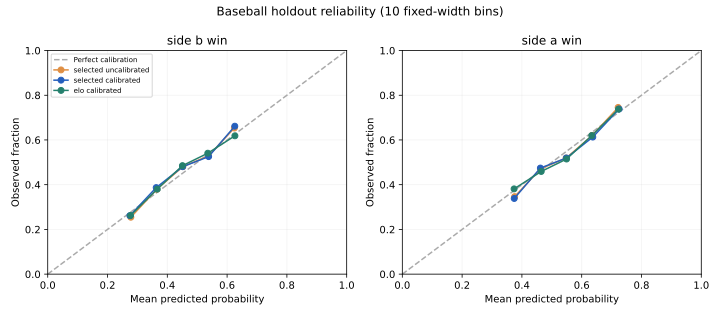
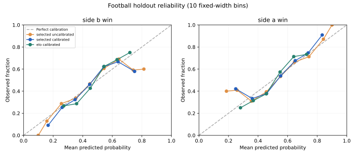
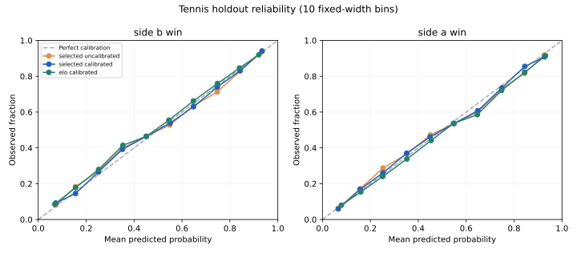

# Historical evaluation results

Generated from the committed evaluation JSON files. These are actual held-out game results, not synthetic test data. Model selection uses earlier chronological training folds. Temperature fitting uses a separate validation year; the final two-year holdout is not used to select parameters.

## Main comparison

The selected model is the calibration-first pipeline fixed before holdout scoring. Lower log loss is better. Accuracy is not the optimization objective.

| Sport | All modeled events | Held-out events | Selected accuracy | Selected log loss | Prior log loss | Calibrated Elo log loss | Brier |
| --- | ---: | ---: | ---: | ---: | ---: | ---: | ---: |
| Soccer | 3,800 | 760 | 54.47% | 0.9576 | 1.0672 | 0.9646 | 0.5685 |
| Baseball | 22,762 | 4,859 | 54.83% | 0.6836 | 0.6927 | 0.6840 | 0.2453 |
| Football | 3,891 | 544 | 64.34% | 0.6395 | 0.6896 | 0.6510 | 0.2244 |
| Tennis | 40,896 | 5,856 | 65.22% | 0.6145 | 0.6936 | 0.6289 | 0.2137 |

Brier score uses mean positive-class squared error for binary targets, and mean sum of squared class errors for soccer. Values are not directly comparable across these target definitions.

## What the results do and do not establish

- All four selected pipelines beat the constant training-frequency baseline on this holdout's log loss
- Tennis has the clearest improvement over calibrated Elo in this experiment; the weekly-bootstrap interval excludes zero
- Soccer, baseball, and NFL improvements over calibrated Elo are small or uncertain: their approximate intervals include zero
- Soccer's calibrated Elo has higher accuracy than its selected model even though its probability log loss is worse
- Temperature calibration slightly worsens soccer and baseball test log loss. Validation calibration improvement is not evidence of generalization
- These datasets are retrospectively corrected snapshots, not immutable historical publication feeds. This is not a live deployment validation or proof of a betting advantage
- No comparison with a university club or commercial model is valid without the same target, information, dates, and evaluation protocol

## Uncertainty and calibration

Paired calendar-week cluster bootstrap with 400 seeded replicates. A negative difference favors the selected model. These approximate intervals omit source revision, model selection, and long-range dependence uncertainty.

| Sport | Selected log-loss interval | Selected minus calibrated-Elo log loss | Difference interval | Top-label ECE (10 bins) |
| --- | --- | ---: | --- | ---: |
| Soccer | [0.9254, 0.9857] | -0.0071 | [-0.0180, 0.0024] | 0.0338 |
| Baseball | [0.6795, 0.6876] | -0.0005 | [-0.0019, 0.0010] | 0.0208 |
| Football | [0.6161, 0.6621] | -0.0115 | [-0.0256, 0.0021] | 0.0287 |
| Tennis | [0.5993, 0.6288] | -0.0144 | [-0.0206, -0.0088] | 0.0149 |

ECE depends on the chosen bins and sample size. Inspect the reliability plots and per-bin counts before describing a model as calibrated; Brier score and log loss jointly measure discrimination and calibration, not calibration alone.

### Soccer

[Full metrics and provenance](soccer/evaluation.json) · [Model card](../docs/model_cards/soccer.md)

### Baseball

[Full metrics and provenance](baseball/evaluation.json) · [Model card](../docs/model_cards/baseball.md)

### Football

[Full metrics and provenance](football/evaluation.json) · [Model card](../docs/model_cards/football.md)

### Tennis

[Full metrics and provenance](tennis/evaluation.json) · [Model card](../docs/model_cards/tennis.md)

## Retrosheet acknowledgment

The information used here was obtained free of charge from and is copyrighted by Retrosheet. Interested parties may contact Retrosheet at "www.retrosheet.org".

Tennis-derived reports: CC BY-NC-SA 4.0, Jeff Sackmann / Tennis Abstract; preserved by Kadantte/tennis_atp. NFL data: Lee Sharpe and nflverse, CC BY 4.0. OpenFootball soccer data: CC0 1.0. See [data rights](../DATA_LICENSES.md).
