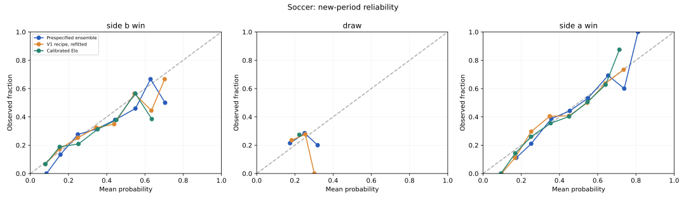
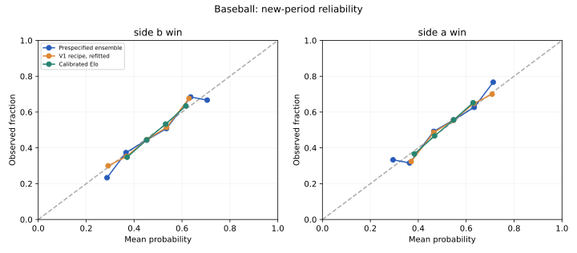
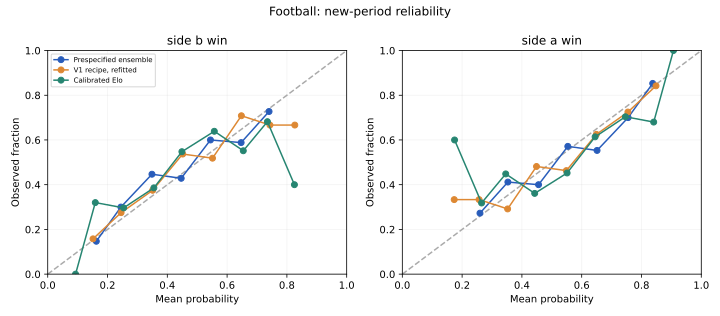
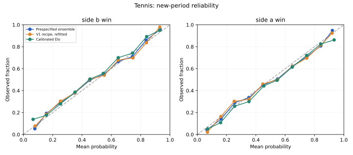

# V2: stronger models on a newer held-out period

The V1 holdout had already been inspected. V2 uses it only as disclosed development history and evaluates on new 2025 periods (EPL 2025–26). All four model selections, stacking weights and calibrators were frozen together before any new-period scoring. The main model was specified as the ensemble in advance; it is not replaced because another row later scored better.

## Same-game comparison against a refitted V1 recipe

| Sport | New test games | Ensemble accuracy | Ensemble log loss | Refitted V1 log loss | Calibrated Elo log loss | Ensemble minus V1 loss | Approximate 95% difference interval |
| --- | ---: | ---: | ---: | ---: | ---: | ---: | --- |
| Soccer | 380 | 47.63% | 1.0265 | 1.0312 | 1.0334 | -0.0047 | [-0.0145, +0.0037] |
| Baseball | 2,430 | 56.21% | 0.6803 | 0.6794 | 0.6810 | +0.0009 | [-0.0022, +0.0042] |
| Football | 271 | 63.84% | 0.6310 | 0.6417 | 0.6698 | -0.0107 | [-0.0231, +0.0033] |
| Tennis | 2,728 | 65.47% | 0.6119 | 0.6160 | 0.6263 | -0.0041 | [-0.0071, -0.0012] |

Negative differences favor V2. These are paired calendar-week bootstrap intervals with 400 replicates. They are unadjusted descriptive intervals, not proof of universal superiority, and do not cover all source, long-range dependence or model-selection uncertainty. Accuracy is secondary to probability log loss.

## What changed

- New 2025 data was structurally audited; MLB franchise continuity and a new EPL score schema were resolved without using model performance
- Longer-horizon, availability-aware strength/form and surface features; new ratings use availability-bucket updates that do not invent within-tournament order
- Rating-only and extended logistic models, histogram boosting, random forests, Extra Trees, and a soccer goal-count baseline
- Three chronological development folds; a learned nonnegative ensemble from out-of-fold predictions; separate calibration year
- All candidate development scores, selected configurations, source/code hashes, ensemble weights, temperatures and software versions retained
- Licensed, odds-free frozen NFL input prevents mutable upstream releases from breaking reproduction

## Interpretation by sport

- Soccer: The difference from the refitted V1 recipe remains uncertain under the approximate interval. Point difference: -0.0047 nats/event
- Baseball: The difference from the refitted V1 recipe remains uncertain under the approximate interval. Point difference: +0.0009 nats/event
- Football: The difference from the refitted V1 recipe remains uncertain under the approximate interval. Point difference: -0.0107 nats/event
- Tennis: The ensemble improves probability log loss relative to the refitted V1 recipe, with an approximate interval below zero. Point difference: -0.0041 nats/event

A new year’s accuracy cannot be directly compared with V1’s older-year accuracy to prove improvement. The refitted V1 column uses the same new matches, training/calibration periods and information-availability rules. Its features retain the original simpler recipe. More complex models are not presumed better.

## All prespecified family comparisons

Tables below are descriptive rankings of completed test results, not post-test model selection. Raw and calibrated variants remain in the machine-readable reports. Different information structures are explicit: the soccer goal model fits team identities, while generic tabular families use the documented numeric features.

### Soccer

Test: 2025-08-15 through 2026-05-24 · 380 events

| Model | Accuracy | Log loss | Brier | Top-label ECE |
| --- | ---: | ---: | ---: | ---: |
| random forest depth6 | 48.68% | 1.02245 | 0.61388 | 0.06846 |
| extra trees depthNone | 48.68% | 1.02534 | 0.61585 | 0.06320 |
| Prespecified ensemble | 47.63% | 1.02655 | 0.61666 | 0.04082 |
| Rating-only logistic | 48.16% | 1.02906 | 0.61941 | 0.05040 |
| V1 recipe, refitted | 47.37% | 1.03122 | 0.62054 | 0.04069 |
| Calibrated Elo | 48.16% | 1.03344 | 0.62164 | 0.04778 |
| logistic C0.1 | 47.89% | 1.03493 | 0.62200 | 0.02933 |
| boost leaves7 | 48.95% | 1.03686 | 0.62230 | 0.04037 |
| Dixon–Coles-style Poisson | 48.42% | 1.04366 | 0.62566 | 0.05629 |
| Training-frequency prior | 42.63% | 1.08400 | 0.65597 | 0.02271 |

[Full evaluation](soccer/evaluation.json) · [Development candidates and frozen selection](soccer/development.json) · [Model card](../../docs/v2/model_cards/soccer.md)

### Baseball

Test: 2025-03-18 through 2025-09-28 · 2,430 events

| Model | Accuracy | Log loss | Brier | Top-label ECE |
| --- | ---: | ---: | ---: | ---: |
| logistic C0.1 | 56.17% | 0.67846 | 0.24283 | 0.00474 |
| V1 recipe, refitted | 56.09% | 0.67943 | 0.24326 | 0.00545 |
| Rating-only logistic | 56.17% | 0.67980 | 0.24347 | 0.00369 |
| Prespecified ensemble | 56.21% | 0.68031 | 0.24371 | 0.00488 |
| Calibrated Elo | 56.34% | 0.68098 | 0.24401 | 0.00850 |
| random forest depth6 | 56.01% | 0.68157 | 0.24430 | 0.00800 |
| boost leaves7 | 55.64% | 0.68168 | 0.24438 | 0.01036 |
| extra trees depth10 | 55.31% | 0.68180 | 0.24443 | 0.01875 |
| Training-frequency prior | 54.28% | 0.68964 | 0.24825 | 0.00899 |

[Full evaluation](baseball/evaluation.json) · [Development candidates and frozen selection](baseball/development.json) · [Model card](../../docs/v2/model_cards/baseball.md)

### Football

Test: 2025-09-04 through 2026-01-04 · 271 events

| Model | Accuracy | Log loss | Brier | Top-label ECE |
| --- | ---: | ---: | ---: | ---: |
| random forest depth6 | 63.47% | 0.63067 | 0.22125 | 0.03987 |
| Prespecified ensemble | 63.84% | 0.63101 | 0.22138 | 0.04802 |
| extra trees depthNone | 64.21% | 0.63160 | 0.22137 | 0.04344 |
| boost leaves7 | 63.47% | 0.63413 | 0.22281 | 0.06982 |
| logistic C0.1 | 62.36% | 0.63450 | 0.22296 | 0.03317 |
| V1 recipe, refitted | 61.25% | 0.64170 | 0.22570 | 0.03649 |
| Rating-only logistic | 64.94% | 0.64289 | 0.22599 | 0.07223 |
| Calibrated Elo | 61.25% | 0.66980 | 0.23702 | 0.05770 |
| Training-frequency prior | 53.87% | 0.69082 | 0.24883 | 0.01828 |

[Full evaluation](football/evaluation.json) · [Development candidates and frozen selection](football/development.json) · [Model card](../../docs/v2/model_cards/football.md)

### Tennis

Test: 2025-01-06 through 2025-12-17 · 2,728 events

| Model | Accuracy | Log loss | Brier | Top-label ECE |
| --- | ---: | ---: | ---: | ---: |
| logistic C10.0 | 65.98% | 0.61076 | 0.21192 | 0.01194 |
| Prespecified ensemble | 65.47% | 0.61186 | 0.21258 | 0.01841 |
| extra trees depth10 | 65.84% | 0.61289 | 0.21303 | 0.01120 |
| boost leaves15 | 65.47% | 0.61393 | 0.21347 | 0.01794 |
| Rating-only logistic | 65.40% | 0.61456 | 0.21374 | 0.00872 |
| V1 recipe, refitted | 64.66% | 0.61599 | 0.21455 | 0.02589 |
| random forest depth6 | 65.62% | 0.61608 | 0.21435 | 0.01458 |
| Calibrated Elo | 63.53% | 0.62633 | 0.21899 | 0.01422 |
| Training-frequency prior | 48.83% | 0.69391 | 0.25038 | 0.02282 |

[Full evaluation](tennis/evaluation.json) · [Development candidates and frozen selection](tennis/development.json) · [Model card](../../docs/v2/model_cards/tennis.md)

## Calibration, uncertainty and exclusions

Brier is positive-class mean squared error for binary tasks and summed classwise squared error for soccer. ECE depends on ten fixed-width bins; inspect reliability counts in JSON. Calibration can worsen a new period and is not assumed successful. NFL/MLB ties and tennis incomplete/unsupported scores are excluded. Tennis dates remain tournament-start proxies, with 21-day result delays and realized-matchup conditioning. These are corrected historical snapshots, not a validated live feed.

## Laya and commercial comparisons

The separately frozen 800-row V1 Laya zero-shot experiment lost to the simpler baselines in all four sports; it was not fine-tuned or used inside V2. [Measured Laya results](../../docs/laya_experiment.md).

A 969-game preserved FiveThirtyEight MLB diagnostic showed a small, uncertain advantage for its pitcher-adjusted forecast over V1, with weaker archival provenance and only 19.94% of the V1 holdout. Verified same-period bulk forecasts were not obtained for the other commercial systems. Missing values are not guessed. [External comparison](../../docs/COMPARATORS.md).

## Reproduce and inspect

[Protocol](../../docs/v2/PROTOCOL.md) · [Reproduction instructions](../../docs/v2/REPRODUCE.md) · [Data audit](../../docs/v2_data_audit.md) · [Source manifest](source_manifest.json) · [All-four selection freeze](selection_freeze.json)

Retrosheet acknowledgment: The information used here was obtained free of charge from and is copyrighted by Retrosheet. Interested parties may contact Retrosheet at "www.retrosheet.org".

NFL: Lee Sharpe/nflverse, CC BY 4.0. Soccer: OpenFootball, CC0. Tennis: Jeff Sackmann/Tennis Abstract, preserved by Kadantte, CC BY-NC-SA 4.0. Combined tennis-derived reports are conservatively distributed under CC BY-NC-SA 4.0; independent code remains MIT. See ../../DATA_LICENSES.md.
